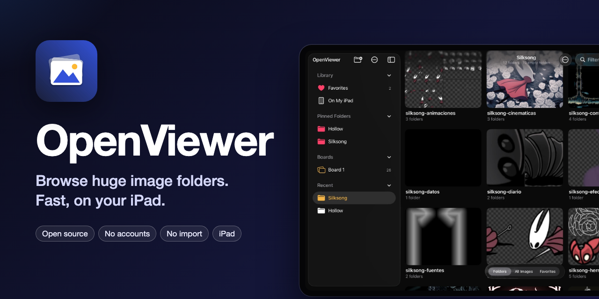

<p align="center">
  
</p>

<h1 align="center">OpenViewer</h1>

<p align="center">
  A fast, lightweight, open-source image viewer for iPad, built to browse <b>huge folders with subfolders</b>.
</p>

---

The Files app opens images one at a time, and Photos only shows your photo library. OpenViewer opens **any folder** that
the Files app can reach (iCloud Drive, On My iPad, USB/SSD drives, SMB servers and third-party providers) and shows
every image in it straight away. Nothing is imported or copied, and there are no accounts or ads.

Speed comes before features. See [`docs/MARKET_STUDY.md`](docs/MARKET_STUDY.md) for the market study (in Spanish)
behind the design.

## Features

- **Open any folder** with the system picker. A sidebar keeps favorites, pinned folders and recent locations one tap away, and the last folder reopens on launch. A breadcrumb path in the title jumps back up any number of levels.
- **Dark gallery look** with floating glass controls (Liquid Glass on iPadOS 26), or match the system appearance.
- **Folder browsing** with mosaic covers (up to four images from inside each folder) and item counts, an option to hide folders that contain no images anywhere inside, or **Include Subfolders** to flatten the whole tree into one grid. The tree is scanned in the background and results stream in as they are found. Sorted by name, the images are grouped under a header per subfolder, and a fast-scroll handle on the right edge jumps anywhere while showing which folder you are in.
- **Justified grid** like Google Photos, where every image keeps its proportions, or a square grid. Pinch or press ⌘+ / ⌘− to resize, sort by natural name, date or size, and filter by name.
- **Full-screen viewer**: swipe between images, double-tap or pinch to zoom, zoom transition from the grid, and swipe down to close. Tap the image for floating controls: a **filmstrip** of thumbnails to jump to any image (plus a slider for big jumps in long collections) and an **info card** beside the image that follows you as you page.
- **Favorites**: tap ♥︎ in the viewer, press F, or long-press a thumbnail. Filter any folder with *Favorites Only*, or open *Favorites* on the start screen to see favorites from all your folders. Folders can be favorited too (long-press a folder, or *Add Folder to Favorites* in the menu) and appear as shortcuts on the start screen. Favorites are stored inside the app and image files are never modified.
- **Select multiple images** like in Google Photos: long-press an image and, without lifting your finger, drag across or down to select a whole range (the grid scrolls by itself near the edges). You can also tap *Select* and then tap or swipe sideways. Share them, add or remove favorites, put them in a new folder, copy or move them anywhere the Files app can reach, or delete them (after a confirmation, they go to Recently Deleted in the Files app when the location supports it). ⌘A selects everything.
- **Compare two images**: select two and tap *Compare*. *Overlay* places B over A with an opacity slider, *Onion Skin* tints A red and B cyan so anything out of place stands out, *Difference* shows only what changed, *Swipe* adds a draggable divider (double-tap it to recentre), and *Side by Side* keeps zoom and pan in sync. It is ideal for checking a scene's art against its collision map. Space flips between A and B, 1–5 switch modes and X swaps them.
- **Play frames as an animation**: numbered images (`walk_01.png`, `walk_02.png`…) play as a flipbook from the viewer (film button or A), a folder's menu (*Play as Animation*) or a selection, with 4–60 fps, loop, ping-pong or play once, and frame stepping. Frames keep their relative sizes, so trimmed sprites don't jump. Animated GIF, APNG, WebP and HEIC sequences open the same way, frame by frame, at the timing saved in the file (*Original*) or any fixed speed.
- **Pixel inspector**: zoom in and a pixel grid appears and pixels stay hard-edged. Long-press to read the exact colour under your finger (HEX, RGB, alpha and x/y), then copy it. Small images and sprites stay crisp in the grid too.
- **Palettes and colour filter**: the info card shows each image's main colours (tap one to copy it), and *Color* in the menu shows only images where a colour family stands out ("everything mossy green").
- **Duplicates and similar images**: *Find Duplicates* (in *Find & Filter*, a folder's long-press menu, or *This Folder* when it only has subfolders) looks among the images shown, or through a folder and all its subfolders. It groups identical, resized or recompressed copies, puts the one to keep first (most pixels, then biggest file, then oldest), and *Select Copies* selects everything else so one delete leaves only the originals. *Find Similar Images* in the viewer lists the images that look most like the current one. Both use a visual fingerprint computed once per image and remembered.
- **Search text inside images**: turn on *Search Text in Images* and the search box also matches signs, legends and labels read from the images themselves (on-device, in the background, remembered).
- **Tags and smart albums**: Finder-style colour tags from the viewer or a selection, shown as dots on thumbnails, with a sidebar entry per tag and a *Tag* filter. *Save as Smart Album…* keeps a folder with its filters (subfolders, name, size, colour, tag, favorites) as a sidebar shortcut.
- **Reference boards**: free canvases to arrange images from any folder. Move, pinch to resize and twist to rotate each image, tap to open it (swipe down to close), and export the whole board as one picture. Add images with *Add to Board* from a selection or the viewer, or with *Add Images from Files…* in the board’s ⋯ menu. *Arrange* lines everything up in a grid of equal cells or in rows of equal height (keeping proportions), in the current reading order, and can be undone.
- **Drag and drop**: while selecting, long-press a selected image and drag the whole selection into Files, Procreate, Notes or another window. In the viewer, drag the title pill to drop the current image. *Open in New Window* on any folder or sidebar shortcut.
- **External display**: connect a TV or monitor (cable or AirPlay, without Stage Manager's extended desktop) and the image open in the viewer fills it while the iPad is the remote; zooming on the iPad zooms the big screen too.
- **Made for sprites and extracted assets**: choose a checkerboard, gray, black or white background for transparent images (*Transparency* in the menu, or B in the viewer), and hide tiny files with *Image Size* (for example, everything under 64 px).
- **Slideshow** at 2, 3, 5 or 10 seconds (long-press the play button).
- **Sidebar like Photos**: collapsible sections, and *Edit Sidebar* (⋯ menu) to reorder pinned folders, smart albums and boards or remove shortcuts.
- **Animated GIF** playback, an **EXIF info** panel, Share, and multi-window / Stage Manager support.
- **Keyboard**: ← → / space to move, Home / End, Esc to close, I for info, F to favorite, B to change the transparency background, S for slideshow, A to play frames, H to hide controls, ⌘O to open a folder, ⌘R to include subfolders, ⌘F to search.
- Formats: everything ImageIO decodes, including JPEG, PNG, HEIC/HEIF, WebP, AVIF, GIF, TIFF, BMP, PSD and RAW (DNG, CR2/CR3, NEF, ARW, RAF, ORF, RW2 and more).

## How it stays fast

| Technique | Effect |
|---|---|
| ImageIO `CGImageSourceCreateThumbnailAtIndex` downsampling | Images are decoded straight at cell or screen size, never at full resolution |
| Embedded EXIF/RAW previews used when large enough | RAW and camera JPEG thumbnails without a full decode |
| Memory cache + JPEG **disk cache** for thumbnails | Revisiting a folder is instant |
| Thumbnail sizes bucketed (256/512/768 px) | Changing the grid size reuses the cache |
| `OperationQueue` with priorities, request coalescing and cancellation | Fast scrolling never decodes off-screen cells |
| `UICollectionView` prefetching + compositional layout | Smooth with 100k+ items |
| Viewer shows the cached thumbnail first, then the screen-sized image, and preloads ±2 neighbours | Paging feels instant |
| High-resolution decode only when you zoom in | Memory stays low |
| Image analysis (colours, fingerprints, text) only on request, in the background, saved per file | Turning a feature on never blocks browsing, and it is instant the second time |
| Duplicate search indexes fingerprint chunks instead of comparing every pair | 50,000 images group in a fraction of a second |

## Building

Requirements: Xcode 16 or later, iPadOS 18+, and [XcodeGen](https://github.com/yonaskolb/XcodeGen).

```bash
brew install xcodegen
xcodegen generate
open OpenViewer.xcodeproj
```

Choose your team under *Signing & Capabilities*, then run on an iPad or an iPad simulator. Tests:

```bash
xcodebuild test -project OpenViewer.xcodeproj -scheme OpenViewer -destination 'platform=iOS Simulator,name=iPad Pro 11-inch (M5)'
```

## Project layout

```
OpenViewer/
  App/        AppDelegate, SceneDelegate
  Model/      ImageItem / FolderItem, sorting, persisted settings
  Services/   FolderScanner, ImagePipeline (decode + caches), BookmarkStore, FolderInfoCache,
              ImageAnalysis (palette, fingerprint, text), DuplicateFinder, TagStore, BoardStore
  UI/         Sidebar, Browser grid, Viewer, zoomable page + pixel tools, Compare, Flipbook,
              Board, external display, Info panel, cells
OpenViewerTests/
docs/MARKET_STUDY.md
```

## Roadmap

- On-demand download of iCloud files that are not stored locally
- Star ratings
- ZIP/CBZ support

Contributions are welcome. Please keep the focus on speed and lightness.

## License

[MIT](LICENSE) © rldona
